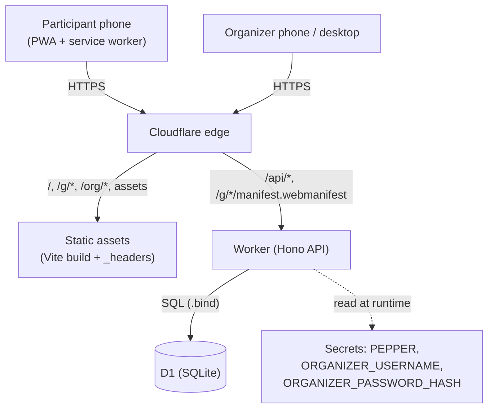
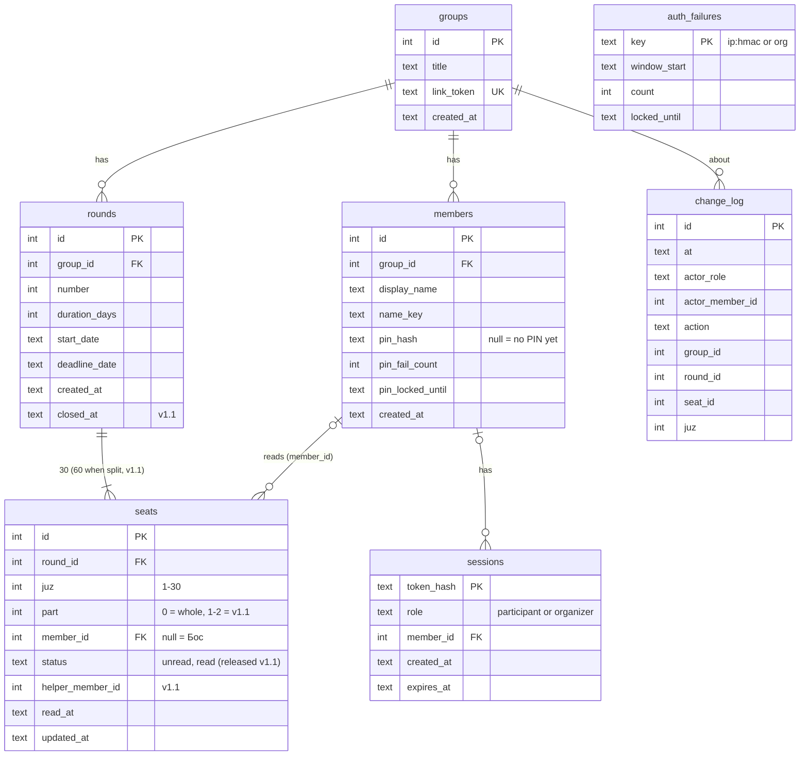
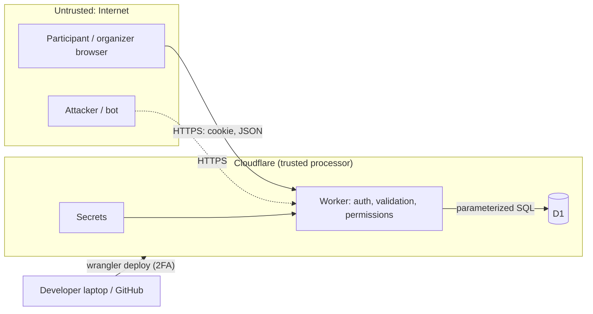

# 02 — Design (v1, launch 23.10.2026)

Status: **Approved 21.10.2026** · Phase 2 of 5 · Builds on `01-requirements.md`

Items marked *(v1.1)* are only prepared for in the design. They are not built for v1.

---

## A. Stack decision (ADR-001)

**Context.** We need a free tier that never pauses, a small database, phone-first performance, and one junior developer who maintains everything alone. Limits were checked on 21.10.2026.

| Option | Pros | Cons | Cost |
|---|---|---|---|
| **1. Cloudflare Workers + D1 (chosen)** | One account, one deploy command. Never pauses, no cold start. Static files are free and unlimited. D1 is SQLite (simple SQL). 7-day point-in-time restore. | Only **10 ms CPU per request**, so slow password hashes don't fit (see §G). Workers is not plain Node. | 0 ₸ |
| 2. Vercel Hobby + Neon Postgres | Full Node.js, bcrypt/argon2 work. Large community. | Hobby is **non-commercial only**, and a client project may break that rule. Neon free **sleeps after 5 min**, so the first request waits. Only 6 h of restore. Two accounts. | 0 ₸ |
| 3. Supabase free / Render free | Many built-in features. | Supabase **pauses after 7 days idle** (needs a manual restore). Render **sleeps after 15 min** (about 1 min to wake up). Breaks the NFR "no pausing". | 0 ₸ |

**Free-tier limits (option 1) vs our need:**

| Limit (free) | Value | Our estimate |
|---|---|---|
| Worker requests | 100,000 / day | ~1,200 / day (60 users × ~20) |
| CPU per request | 10 ms | ≤ 5 ms target (login), < 1 ms for other requests |
| D1 rows read / written | 5M / 100k per day | < 50k / < 1k |
| D1 size | 500 MB per DB, 10 DBs | < 1 MB |
| D1 Time Travel (restore) | 7 days | meets "max loss 7 days" |
| Static assets | free, not counted as Worker requests | — |

When a daily limit is hit, requests fail until 00:00 UTC (05:00 in Kazakhstan). Our usage is about 1% of the limits.

**Decision.** Option 1. **Consequences:** we use the WebCrypto API instead of bcrypt (§G), and all code must run in the Workers runtime.

**Libraries (few on purpose, R9):**

| Part | Choice | Why |
|---|---|---|
| API | **Hono** | Tiny, made for Workers, Express-like and easy to read |
| UI | **Preact + @preact/signals** | React-style (≈ 5 KB). Signals update only the changed element. |
| Build / dev | **Vite + @cloudflare/vite-plugin** | One `npm run dev` runs the UI, the API and a local D1 together |
| PWA | **vite-plugin-pwa** (Workbox) | Generates the service worker and precache list |
| Validation | **Our own small functions** in `src/shared/validation.ts` | The same rules run in the browser (preview) and on the server. Zero dependencies. |
| Tests | **Vitest + @cloudflare/vitest-pool-workers**; Playwright in Phase 4 | API tests run in the real Workers runtime with a real local D1 |
| Quality | TypeScript strict, ESLint (typescript-eslint), Prettier | |

---

## B. Architecture



- A **single-page app (SPA)** is served as static files. Wrangler setting: `not_found_handling: "single-page-application"`, so `/g/<token>` and `/org/...` return `index.html`.
- `run_worker_first: ["/api/*", "/g/*/manifest.webmanifest"]` sends only these paths to the Worker.
- The browser talks to the API with `fetch` on the same origin, so there is **no CORS**.

---

## C. Data model

All timestamps are UTC ISO-8601 text. `start_date` and `deadline_date` are **calendar dates in UTC+5** (`YYYY-MM-DD`). The deadline is that day at 23:59 UTC+5 (BR-3).



**Rules in the schema (`migrations/0001_init.sql`):**
- `UNIQUE(group_id, name_key)`: duplicate names are refused (decision 6). `name_key` = the trimmed, lower-cased name.
- `UNIQUE(round_id, juz, part)`, plus `CHECK` constraints on `juz` 1–30, `status`, `duration_days IN (7,15,20,30)` and `role`.
- `groups.link_token` = 16 random bytes (128 bits), base64url. Stored in plain text because the organizer must copy it.
- `change_log` is **append-only**: triggers `BEFORE UPDATE` / `BEFORE DELETE` run `RAISE(ABORT)` (S-1). Actions: `create_khatm`, `mark`, `unmark`, `undo`, `pin_set`, `pin_reset`.
- `auth_failures` rows older than 15 minutes are deleted on the next write, so IPs (and even their HMACs) are never kept long-term.
- Organizer: no table. There is one account, from environment variables.

**Derived, never stored:** page range (BR-1, in `src/shared/juz.ts`), «Бос» (`member_id IS NULL`), «Мерзімі өтті», days left (BR-4/5), progress X/30 and «Хатм аяқталды» (BR-6).

---

## D. API

Base: same origin, `/api`, JSON, camelCase.
- **No version prefix:** the UI and the API are always deployed together as one build, so they can't get out of sync. If we ever need a public API, we add `/api/v2`.
- **No pagination:** every list has ≤ 30 rows (a few groups, 30 seats).

**Error body** (all 4xx/5xx): `{ "code": "wrong_pin", "triesLeft": 3 }`. Optional fields: `fields` (validation codes, e.g. `{ "names": { "code": "duplicate", "line": 4, "firstLine": 1 } }`), `triesLeft`, `retryAfter` (seconds). The UI maps `code` to Kazakh texts. A 500 never contains details.

**Every request that changes data** (POST/PUT/DELETE):
- needs `Origin` = our origin (otherwise 403 `bad_origin`);
- needs `Content-Type: application/json` (otherwise 415);
- has a body ≤ 10 KB (otherwise 413).

| # | Method + path | Who may call | Request → 200 response | Errors |
|---|---|---|---|---|
| 1 | GET `/api/g/:token` | anyone with the link | → `{ title, round:{durationDays, deadlineDate}, members:[{id, name, juz, hasPin}] }`, members sorted A–Я (Kazakh alphabet) | 404 `bad_link` (same for every bad token) |
| 2 | POST `/api/g/:token/login` | anyone with the link | `{ memberId, pin, pinConfirm? }` → sets cookie `__Host-hatm_p`, `{ ok:true }`. If the member has no PIN yet, `pinConfirm` is required and the PIN is created. | 400 `invalid` / `pin_mismatch` · 401 `wrong_pin` + `triesLeft` · 404 `bad_link` · 409 `pin_already_set` · 429 `locked` / `too_many` + `retryAfter` |
| 3 | GET `/api/me` | participant | → `{ group:{title, linkToken}, round:{deadlineDate, durationDays}, today, me:{memberId, name, seatId}, seats:[{id, juz, name\|null, status, readAt}] }`. `linkToken` lets the app check that the session belongs to the group link that was opened (otherwise it shows that group's name list). | 401 `no_session` |
| 4 | PUT `/api/me/seats/:seatId/status` | participant, **own seat only** | `{ read: bool, via?: "undo" }` → `{ seat }` | 400 · 401 · 403 `forbidden` (also for a seat that doesn't exist, so seat ids can't be probed) |
| 5 | POST `/api/logout` | participant | → clears cookie, deletes session | — (always 200) |
| 6 | POST `/api/org/login` | anyone | `{ username, password }` → cookie `__Host-hatm_o` | 401 `wrong_login` (same for wrong user or password) · 429 |
| 7 | POST `/api/org/logout` | organizer | → clears cookie, deletes session | — |
| 8 | GET `/api/org/groups` | organizer | → `{ today, groups:[{id, title, link, durationDays, deadlineDate, read, total:30}] }`, newest first. `link` is the full group link (for «Сілтемені көшіру» on mockup 5). | 401 |
| 9 | GET `/api/org/groups/:id` | organizer | → `{ id, title, link, round, today, seats:[{id, juz, memberId, name, status, readAt}], members:[{id, name, hasPin}] }` | 401 · 404 |
| 10 | PUT `/api/org/seats/:seatId/status` | organizer | `{ read: bool }` → `{ seat }` (works for «Бос» too) | 400 · 401 · 404 |
| 11 | DELETE `/api/org/members/:id/pin` | organizer | → `{ ok:true }`; clears PIN + fail count + lock, deletes that member's sessions, logs `pin_reset` | 401 · 404 |
| 12 | POST `/api/org/khatms` | organizer | `{ title, durationDays, names:[raw lines] }` → 201 `{ groupId, link }`. One transaction. | 400 `{ code:"invalid", fields:{ title?, durationDays?, names?:{code, line…} } }`: codes, which the app turns into Kazakh texts (the same codes the form's live check uses) |
| 13 | GET `/g/:token/manifest.webmanifest` | anyone with the link | → web app manifest for this group (§H) | 404 |

**Server-side checks (every request):** session → role → ownership. For #4, the server loads the seat and checks `seat.member_id = session.member_id` and that the seat is in the member's current round. It never trusts IDs sent by the client.

**Validation (shared, `src/shared/validation.ts`):**
- **title:** 1–80 characters after trim.
- **durationDays:** one of 7/15/20/30.
- **names:** 1–30 after removing empty lines; each 1–40 characters of letters (including Kazakh letters), spaces, `.`, `-` and `'`; no duplicates, case-insensitive.
- **pin:** `^\d{4}$`.
- Control characters are removed before checking.

---

## E. Concurrency rules

D1 is SQLite, so the database applies **one write at a time**. Every change is **one `db.batch()`** (a transaction): the state change and its `change_log` row are saved together or not at all.

| Situation | Rule | Result |
|---|---|---|
| Double tap / repeated request | The request **sets** `status` (BR-7). It never toggles. | Same final state. A second log row is only written if the state actually changed. |
| Organizer and participant change the same seat | Applied in arrival order (BR-8). The response returns the new seat. | The last write wins. Both are logged. Others see it on the next refresh. |
| Two people set a PIN on the same name at once | `UPDATE members SET pin_hash=? WHERE id=? AND pin_hash IS NULL`, then check `meta.changes`. | One wins. The other gets 409 `pin_already_set` → "enter PIN". |
| Many wrong PINs at once | Counters updated in SQL (`pin_fail_count = pin_fail_count + 1`), never read-then-write in JS. | No lost counts, so the lock can't be bypassed. |
| *(v1.1)* Two people take the same released juz | `UPDATE seats SET helper_member_id=? WHERE id=? AND status='released' AND helper_member_id IS NULL` + `meta.changes`. | Exactly one wins. The other gets 409 `already_taken`. |

---

## F. Identification and sessions

- **Group link:** `https://<host>/g/<token>`. The token is the only key to a group. A bad token always returns the same 404.
- **Participant login:**
  1. Open the link and pick a name.
  2. If the name has no PIN yet: enter the PIN twice → PIN saved (`pin_set` logged). If it has one: enter the PIN.
  3. The server creates a session and sets the cookie `__Host-hatm_p` (`HttpOnly; Secure; SameSite=Lax; Path=/; Max-Age=1 year`).
- **Organizer login:** username + password, checked against the secrets `ORGANIZER_USERNAME` and `ORGANIZER_PASSWORD_HASH`. The username is compared in constant time and the password is always hashed, so a wrong username and a wrong password look the same (same 401, same time). Cookie `__Host-hatm_o`, 30 days. The hash is made with `npm run hash-password`: it asks for the environment's PEPPER and the password with hidden input (never command arguments), at least 6 characters, typed twice.
- **Session storage:** the token is 32 random bytes. Only `SHA-256(token)` is stored, in `sessions`. Every request looks up the row and checks `expires_at`. Logout and PIN reset delete rows, so a session ends at once.
- **One participant session per device (v1).** Logging in to another group replaces it.
- **Rate limits** (checked **before** hashing, to save CPU):
  - Per name: 5 failures → `pin_locked_until = now + 15 min`. Reset on success.
  - Per IP: 20 failures per 15 min. Key = `ip:` + HMAC(PEPPER, CF-Connecting-IP).
  - Organizer: 5 failures → 15-minute lock (key `org`), plus the same per-IP limit.
- **PIN reset:** the organizer calls API #11. The person's next visit is a "first visit" (create a PIN).
- **iPhone:** the installed home-screen app has its own cookies, so the person logs in once more there (said in the install help, §J). Safari's 7-day cap applies only to cookies set by JavaScript; ours are set by the server with HttpOnly.

---

## G. PIN and password hashing

**Why not argon2/bcrypt:** the free Workers plan allows 10 ms CPU per request, and those algorithms need much more.

**Why this is still safe:** a 4-digit PIN has only 10,000 values. If the DB leaked, *any* slow hash would be cracked within minutes. The real protection is the **pepper**, a secret that is *not* in the database. Online guessing is stopped by the rate limits in §F.

**Algorithm (`src/worker/auth/hash.ts` makes hashes and also runs in Node for `npm run hash-password`; `verify.ts` checks them and needs the Workers-only `timingSafeEqual`):**
```
key    = HMAC-SHA256(PEPPER, pin_or_password)          // pepper
salt   = 16 random bytes, new for every hash          // per-user salt
hash   = PBKDF2-SHA256(key, salt, ITERATIONS, 256 bits)
stored = "pbkdf2$sha256$<ITERATIONS>$<salt b64>$<hash b64>"
verify = crypto.subtle.timingSafeEqual(...)            // constant-time compare
```
The iteration count is stored in each hash, so we can raise it later. Old hashes still verify.

**Measurement of ITERATIONS:**

| Iterations | Local (M-series Mac, Node WebCrypto) | Workers staging, CPU time median / p95 / **p99** (T0.5, 21.10.2026) |
|---|---|---|
| 10,000 | 2.1 ms | 3 / 4 / **4 ms** |
| 20,000 | 3.8 ms | 6 / 7 / **9 ms** |
| 50,000 | 12.2 ms | 13 / 17 / **18 ms** |
| 100,000 | 22.5 ms | 27 / 34 / **34 ms** |

**Rule:** choose the **highest** count whose *whole login request* stays ≤ **5 ms CPU at p99** on staging (half the 10 ms limit). We expected about 20,000, but staging is slower than a laptop.

**How we measured (T0.5):** a temporary endpoint on staging ran one hash per request. We called it 50 times per count, one request at a time, twice, and read `cpuTime` with `wrangler tail` (which logs about half of the requests: 24–27 samples per count in the run above; the first run agreed). CPU time is reported in whole milliseconds.

**Final value: 10,000 iterations** (`PBKDF2_ITERATIONS` in `src/worker/auth/hash.ts`). 20,000 reached 9 ms at p99, too close to the limit. The endpoint was deleted after the measurement.

**Pepper rules:**
- It is a Cloudflare secret (`wrangler secret put PEPPER --env staging` / `--env production`): **different per environment**, never in code, git or `wrangler.jsonc`. Generate it with `openssl rand -base64 32`.
- **Back it up in your password manager.** If it is lost, every PIN and the organizer password stop working. To recover: set a new pepper → a new organizer hash → all participants create new PINs (organizer resets them). This goes into the README and the Phase 5 maintenance guide.
- The organizer password uses the same function (≥ 6 characters, 5-fail lock).

---

## H. PWA

- **Manifest per group** (API #13): `name "Хатм — <title>"`, `short_name "Хатм"`, `lang "kk"`, `display "standalone"`, `start_url "/g/<token>"`, `scope "/"`, `theme_color` / `background_color`. The SPA points `<link rel="manifest">` at it, so the installed app opens on the right group.
  - **Risk:** iOS support has to be checked on a real iPhone early (T1.9). **Fallback:** a static `/manifest.webmanifest` with no `start_url`, so iOS uses the current page URL.
- **Icons:** made from one SVG: 192, 512, maskable 512 and `apple-touch-icon` 180 (PNG files, no inline data).
- **Service worker** (vite-plugin-pwa, `generateSW`):
  - **Precaches the app shell only** (HTML, JS, CSS, icons). The API is **not** cached by the service worker.
  - Update strategy: `registerType: "autoUpdate"`. A new version loads on the next start.
  - `injectRegister: false`: registration is done by `registerSW()` from `virtual:pwa-register` inside `main.tsx`, so there is **no inline script** (CSP).
- **Offline (decision 11):** the app stores the last `/api/me` response in `localStorage` and shows it read-only with the «Интернет жоқ» banner. Buttons stay available; tapping one shows "Интернет жоқ" and changes nothing (P-3). The data is cleared on «Шығу». *(Cut item 1: only the banner.)*
- **WhatsApp link preview** only sees the empty HTML shell, so no names leak.

---

## I. Threat model



| # | Threat (STRIDE) | Sev. | Mitigation | Risk |
|---|---|---|---|---|
| T1 | Member changes another person's seat via the API (Tampering/EoP) | High | Owner check on the server for #4 (§D), API tests for 403, log | R1 |
| T2 | Name claiming: sets a PIN on someone else's name first (Spoofing) | Med | Conditional PIN set (§E), `pin_set` logged, organizer reset ends sessions | R2 |
| T3 | PIN guessing (Spoofing) | Med | Per-name + per-IP limits, checked before hashing (§F) | R3 |
| T4 | Organizer password brute force (Spoofing) | High | 5-fail lock + IP limit, pepper + PBKDF2, same error message | R4 |
| T5 | XSS through names or titles (Tampering) | High | Validation; Preact escapes all text; lint bans `dangerouslySetInnerHTML` and string `style` values; strict CSP | R5 |
| T6 | CSRF (a foreign site posts to our API) | Med | `SameSite=Lax` cookies + `Origin` check + JSON-only content type | — |
| T7 | Session theft / reuse (Spoofing) | Med | HttpOnly + Secure `__Host-` cookies, hashed tokens, server-side delete | R11 |
| T8 | Link leaks (Info disclosure) | Med | `Referrer-Policy: no-referrer`; our code never logs paths or tokens; only first name + initial | R6 |
| T9 | Bots use up the free quota → site down until 05:00 (DoS) | Med | **Accepted risk:** `workers.dev` has no WAF rate rules. Uptime alert; a custom domain + WAF is in suggestions. | R7 |
| T10 | DB leak (Info disclosure) | Med | Pepper outside the DB; no phone numbers or surnames; session tokens hashed | R12 |
| T11 | Vulnerable / malicious npm package | Med | Few dependencies, lockfile, `npm audit` + Semgrep in CI | R9 |
| T12 | Developer account takeover | High | 2FA on GitHub + Cloudflare; secrets only in Cloudflare/GitHub secrets; gitleaks in CI | R10 |
| T13 | Log tampering (Repudiation) | Low | Append-only triggers on `change_log` | — |
| T14 | Cloudflare Workers Logs store request URLs, which include group link tokens (`/api/g/<token>`) (Info disclosure) | Low | **Accepted risk (21.10.2026):** only the developer's Cloudflare account (with 2FA) can see the logs; Cloudflare keeps them only a few days; they are needed for debugging and error monitoring. Our own code still never logs paths or tokens. | R6 |

**Headers** (static files via `public/_headers`, API via Hono middleware):
```
Content-Security-Policy: default-src 'self'; script-src 'self'; style-src 'self'; img-src 'self' data:;
  connect-src 'self'; manifest-src 'self'; worker-src 'self'; object-src 'none'; base-uri 'none';
  form-action 'self'; frame-ancestors 'none'
Strict-Transport-Security: max-age=31536000; includeSubDomains
Referrer-Policy: no-referrer
X-Content-Type-Options: nosniff
X-Robots-Tag: noindex
Cache-Control: no-store            (API responses only)
```
**No inline code:** `build.assetsInlineLimit: 0`, no inline `<script>` or `<style>` in `index.html`, PWA registration bundled (§H). Checked on staging in T1.8 (`curl -I` + 0 CSP errors in the console).

**Dynamic styles and CSP (tested 21.10.2026, headless Chrome, `style-src 'self'`):**

| Way to set a style | Result |
|---|---|
| `style="…"` in HTML, `setAttribute('style', …)`, `innerHTML` with `style` | **blocked** |
| `el.style.width = …`, `el.style.setProperty(…)`, `el.style.cssText = …` (CSSOM, through JavaScript) | allowed |

Preact applies the `style` prop through the CSSOM (`style[key] = …` / `setProperty` for objects, `cssText` for strings; never `setAttribute`), so it is allowed.

**Rule:**
- Use `style` **only for dynamic values** and **only as an object**, e.g. the progress bar `style={{ width: `${pct}%` }}`. Everything else goes through CSS classes.
- Lint bans string `style` values.
- Safari is checked on a real iPhone in T1.8.

**Attack surface removed:** no sign-up, email, SMS or file upload; no third-party scripts, fonts or analytics; no CORS; no log screen; no debug endpoints in production (the T0.5 measurement endpoint is deleted); one organizer account only.

---

## J. Screens (phone, 320 px and up)

**Visual target:** the screen mockups ("Хатм экрандары" design canvas, 21.10.2026) replace the wireframes below: 1 name list (A–Я, with juz number), 2 PIN create, 3 home (unread), 4 home after «Оқыдым», 5 organizer groups, 6 organizer group with "only unread" filter and action sheet (5–6: Iteration 2). The frontend-design plugin may polish details but **must not change the layout, colours or texts** of the mockups. Two deliberate differences: buttons drawn 44 px high are 48 px (accessibility checklist), and screens not drawn (PIN entry, last day, overdue, finished, «Шығу» confirm, «Сілтеме қате») reuse the mockups' parts and colours.

**Home: «Оқыдым» flow (inside the juz card):** unread → tap «Оқыдым» → «Белгіленді» + «Қайтару» for 15 s → «Рақмет! Сіз бұл параны оқыдыңыз.» + «Белгіні алып тастау» → inline confirm «Белгіні алып тастайсыз ба?» («Иә, алып тастау» / «Жоқ»). «Шығу» uses the same inline confirm: «Шығасыз ба? Осы телефонда басқа адам өз есімін таңдай алады.» («Иә, шығу» / «Жоқ»). Inline panels replace the `<dialog>` for participants (as drawn); focus moves to the panel.

*Original wireframes (superseded by the mockups):*

Base text is 18 px, buttons are ≥ 48 px high with ≥ 8 px gaps, and statuses use an icon + text. All texts live in `src/web/texts.kk.ts` (checked and approved by the developer in T3.6, 22.10.2026).

```
P-a  Name list (/g/<token>)          P-b  PIN                         P-c  Home
┌──────────────────────────┐        ┌──────────────────────────┐    ┌──────────────────────────┐
│ Хатм: Рамазан хатмы      │        │ ← Айгүл А.               │    │ Айгүл А.     [Мен емеспін]│
│ Атыңызды таңдаңыз        │        │ PIN ойлап табыңыз (4 сан)│    │ ┌──────────────────────┐ │
│ ┌──────────────────────┐ │        │ [ • • • • ]              │    │ │  12-пара             │ │
│ │ Айгүл А.             │ │        │ PIN-ді қайталаңыз        │    │ │  222–241 беттер      │ │
│ ├──────────────────────┤ │        │ [ • • • • ]              │    │ │  Мерзімі: 27.10      │ │
│ │ Бауыржан Т.          │ │        │ ┌──────────────────────┐ │    │ │  3 күн қалды         │ │
│ ├──────────────────────┤ │        │ │        Кіру          │ │    │ │ ┌──────────────────┐ │ │
│ │ ...                  │ │        │ └──────────────────────┘ │    │ │ │    ✓ Оқыдым      │ │ │
│ └──────────────────────┘ │        │ (error text, aria-live)  │    │ │ └──────────────────┘ │ │
└──────────────────────────┘        └──────────────────────────┘    │ └──────────────────────┘ │
                                                                    │ ▸ Телефонға орнату        │
Bad link: "Сілтеме қате" only.                                      │ Барлығы: 14 / 30 [Жаңарту]│
After «Оқыдым»: toast "Сақталды" + [Болдырмау] for 15 s.            │ 1 ✓ Оқыды   Әлия Б.      │
Later: the card shows "✓ Оқылды" + [Белгіні алып тастау] → dialog.  │ 2 ○ Оқылмады Нұрлан С.   │
                                                                    │ 3 — Бос                  │
                                                                    └──────────────────────────┘
O-a Login        O-b Groups                    O-c Group detail                  O-d Create khatm
┌────────────┐  ┌───────────────────────┐    ┌───────────────────────────┐    ┌──────────────────────┐
│ Логин [  ] │  │ Топтар       [Шығу]   │    │ ← Рамазан хатмы           │    │ Атауы [            ] │
│ Құпия сөз  │  │ [+ Жаңа хатм]         │    │ Мерзімі 27.10 · 14/30     │    │ Мерзімі (7)(15)(20)(30)│
│ [        ] │  │ ┌───────────────────┐ │    │ [Сілтемені көшіру]        │    │ Аттар (әр жолда біреу)│
│ [  Кіру  ] │  │ │Рамазан хатмы 14/30│ │    │ [■] Тек оқылмағандар      │    │ ┌──────────────────┐ │
└────────────┘  │ │27.10 · 3 күн      │ │    │ 2 ○ Нұрлан С.      [⋯]    │    │ └──────────────────┘ │
                │ └───────────────────┘ │    │ 3 — Бос            [⋯]    │    │ Алдын ала қарау:      │
                └───────────────────────┘    └───────────────────────────┘    │ 1 → Айгүл А. ...      │
[⋯] opens an action sheet: Оқылды деп белгілеу / Белгіні алу / PIN-ді өшіру   │ [ Құру ]              │
(each change that removes something asks for confirmation)                     └──────────────────────┘
```

**Install help (P-6):**
- **iPhone:** "Бөлісу ⬆ → «Басты экранға қосу». Үй экранындағы қосымшада PIN-ді тағы бір рет енгізесіз." (Share ⬆ → "Add to Home Screen". You enter your PIN once more inside the installed app.)
- **Android:** the install button (if the browser offers it) or the "⋮ → Басты экранға қосу" steps.
- Hidden when the app is already running in standalone mode.

**Dialogs:** participant screens use the inline confirm panels from the mockups (above). Organizer screens (Iteration 2) use the action sheet from mockup 6.

---

## K. Front-end structure

```
src/web/
  main.tsx            entry, registerSW(), router start
  router.ts           tiny router: /g/:token → participant, /org/* → organizer, else "Сілтеме қате"
  api.ts              fetch wrapper: JSON, error codes → texts, offline detection
  texts.kk.ts         all Kazakh texts
  state/
    participant.ts    signals: session, groupView, seats: Map<seatId, Signal<Seat>>
    organizer.ts      signals: groups, currentGroup, filterUnread (computed list)
  screens/            NameList, PinForm, Home, OrgLogin, OrgGroups, OrgGroup, OrgCreate, BadLink
  components/         JuzCard, SeatRow, ProgressBar, ConfirmPanel, StatusChip, OfflineBanner, InstallHelp
```
- **One signal per seat:** a tap updates one signal, so only that `SeatRow` and the counter re-render (no whole-page re-render).
- **Optimistic UI? No.** While a request is waiting, the button shows loading and is **disabled** (no double submit). On success, the new state from the server is shown (≤ 1 s target). On failure, the **old state stays** and a clear error is shown: "Интернет жоқ. Қайталап көріңіз." (or the matching text for the error code). This keeps the shown state always true.
- **Refresh:** on `visibilitychange` → visible, on «Жаңарту», and on pull-to-refresh at the top of the list.
- **Size:** target < 50 KB JS gzipped (budget 150 KB). Checked in CI with a simple size script.

---

## L. Repository and standards

```
hatm/
  src/shared/      juz.ts (BR-1), dates.ts (BR-3/4/5), progress.ts (BR-6), validation.ts, types.ts
  src/worker/      index.ts (Hono app), routes/, auth/ (hash, session, rateLimit), db/, middleware/ (headers, origin, bodyLimit)
  src/web/         (see §K)
  migrations/      0001_init.sql
  scripts/         hash-password.ts, seed-khatm.ts
  public/          icons, _headers
  tests/           unit + API tests next to the code as *.test.ts; tests/e2e/ (Playwright, Phase 4)
  .github/workflows/ci.yml
  wrangler.jsonc, vite.config.ts, tsconfig.json, eslint.config.js, .prettierrc, .dev.vars.example
```
- **Coding standards:**
  - TypeScript `strict`. Small functions with clear names. Business rules only in `src/shared/` (pure functions, fully unit-tested).
  - SQL only with `.prepare(...).bind(...)`, never string-built.
  - No `any` (lint), no `dangerouslySetInnerHTML`. `style` only as an object and only for dynamic values (§I).
  - Formatting is done by Prettier, so nobody argues about style.
- **Branching:** GitHub Flow. A short branch `feat/<task-id>-<name>` or `fix/<name>` → PR → review → squash-merge to `main`. `main` always deploys.
- **Commits:** Conventional Commits: `feat: ...`, `fix: ...`, `docs: ...`, `test: ...`, `chore: ...`.
- **CI on every PR** (GitHub Actions): Unicode check (no invisible or bidirectional characters in any file) → `npm ci` → lint → typecheck → tests → `npm audit --audit-level=high` → gitleaks (secret scan) → Semgrep CE (static security analysis; CodeQL is not free for private repos) → bundle-size check.
- **Merge only when CI is green.** On a free private repo, GitHub doesn't enforce branch protection, so this is our own rule, checked in every PR review.

---

## M. Environments

| | local | staging | production |
|---|---|---|---|
| Purpose | development | UAT with the client, real-phone tests | real users |
| Worker | `npm run dev` (Vite + workerd) | `hatm-staging` | `app` |
| URL | `http://localhost:5173` | `https://hatm-staging.hatm.workers.dev` | `https://app.hatm.workers.dev` |
| Database | local D1 (miniflare, `.wrangler/`) | D1 `hatm-staging` (region EEUR) | D1 `hatm-prod` (region EEUR, T3.7) |
| Secrets | `.dev.vars` (gitignored, example file in git) | `wrangler secret put … --env staging` | `wrangler secret put … --env production` (**different values**) |
| Data | seed script | test khatms | real khatms only |
| Deploy | — | `npm run deploy:staging` | `npm run deploy:prod` (manual, same commit as UAT); `wrangler rollback --env production` to undo |

**Backups:**
- D1 Time Travel lets us restore to any minute in the last 7 days (`wrangler d1 time-travel restore`).
- **Plus** a weekly scheduled GitHub Actions export (`wrangler d1 export`), uploaded as an artifact kept 90 days. It uses a Cloudflare API token limited to D1, stored as a GitHub secret.
- The repo is **private**, so the artifacts are private (only repo members can download them) and are not encrypted.
- Done in Phase 5 (a weekly backup job in the private repo): every run checks that the file restores. The token has **D1 Read** only.
